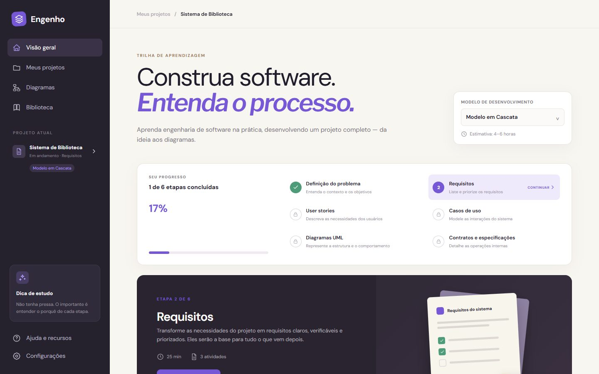
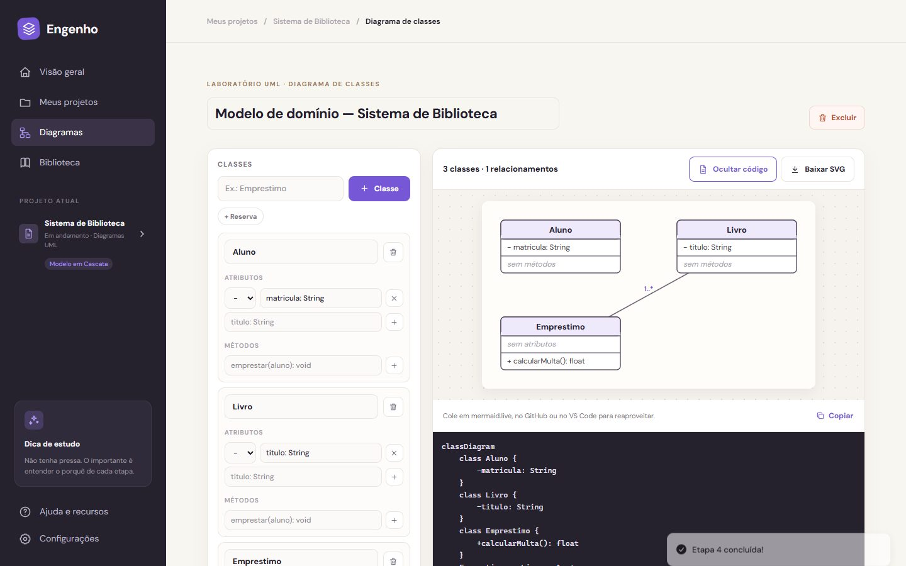
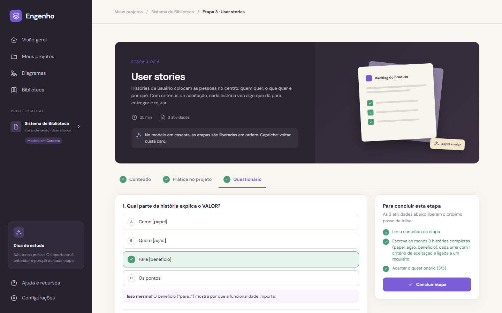

# Engenho — aprenda engenharia de software na prática

Plataforma de estudo para quem está começando em engenharia de software. O aluno escolhe um **modelo de desenvolvimento** e constrói um projeto completo, etapa por etapa:

1. definição do problema;
2. requisitos;
3. user stories;
4. casos de uso;
5. diagramas UML;
6. contratos.

Ao final, o aluno tem um documento pronto para entregar.

Design de origem: Figma Make (`Figma Make Projects/Software Engineering Study Tool`).

**Status (11/10/2026):** front-end completo e funcionando, **sem login**: os dados ficam salvos no navegador, com exportação e importação em arquivo.

## Telas

**Visão geral (trilha de aprendizagem)**



**Editor de diagrama de classes (desenho UML automático + código Mermaid)**



**Etapa com conteúdo, prática no projeto e questionário**



## Como funciona

Cada etapa tem **3 atividades**:

- **Conteúdo:** lição curta, com exemplos aplicados.
- **Prática no projeto:** editor próprio da etapa.
- **Questionário:** 3 perguntas, com correção e explicação na hora.

A etapa só é concluída quando as três estão feitas.

| Etapa | Prática |
| --- | --- |
| 1. Definição do problema | Contexto, objetivos, partes interessadas, escopo e fora do escopo |
| 2. Requisitos | Funcionais e não funcionais (RF01, RNF01…), priorização **MoSCoW** e um **corretor** que aponta termos vagos ("rápido", "fácil", "amigável"…) |
| 3. User stories | "Como… quero… para…", critérios de aceitação, pontos (Fibonacci) e ligação aos requisitos |
| 4. Casos de uso | Ator, pré e pós-condições, fluxo principal e alternativos; o **diagrama de casos de uso é gerado sozinho** |
| 5. Diagramas UML | **Classes** (atributos, métodos, herança, composição, agregação, associação, dependência) e **sequência** (participantes, mensagens e respostas), desenhados automaticamente |
| 6. Contratos | Operações sugeridas a partir dos diagramas, com pré e pós-condições |

**Modelos de desenvolvimento:**

- **Cascata e Espiral:** as etapas são liberadas **em ordem**.
- **Ágil e Prototipação:** as etapas ficam **livres**.

Cada modelo tem a sua estimativa de tempo e dicas próprias.

**Outras telas:**

- **Meus projetos:** modelos prontos (Biblioteca, Delivery, Clínica), duplicar e excluir projetos. Exporta o **documento Markdown** completo, com os diagramas em Mermaid, e salva cópias em `.json` para importar depois.
- **Diagramas:** laboratório UML. Cada diagrama pode ser baixado em **SVG** e copiado como código **Mermaid**.
- **Biblioteca:** lições, comparação dos modelos, **matriz de rastreabilidade** (requisito → história → caso de uso) e glossário.
- **Ajuda** e **Configurações:** backup, restauração e voltar à demonstração.

## Stack

Next.js 16 · React 19 · TypeScript · MobX · Tailwind CSS 4 (CSS do design + `complementos.css`) · sonner · Vitest · Puppeteer

| Onde | O quê |
| --- | --- |
| `src/modules/domain/` | Tipos, conteúdo das etapas (`curriculum.ts`), regras e corretor (`rules.ts`), modelos de projeto, exportação Markdown/Mermaid |
| `src/modules/study/` | `StudyStore` (MobX) e o provedor que salva no navegador |
| `src/modules/diagrams/` | Desenho UML em SVG (`render.tsx`) e editores |
| `src/modules/steps/` | Tela da etapa, questionário e os 6 editores |

## Rodando

```bash
npm install
npx next dev -p 3011
```

## Testes

```bash
npm test
```

São 18 testes unitários: corretor, histórias, casos de uso, contratos, trilha, modelos, diagramas, Mermaid e exportação.

Com o site rodando, em outro terminal:

```bash
npm run test:flows -- http://localhost:3011
```

Aqui são 9 fluxos completos: o aluno percorre as 6 etapas e cria os diagramas.

```bash
npm run test:smoke -- http://localhost:3011
```

O smoke passa por 15 páginas. Use `MOBILE=1` para testar no tamanho de celular.

Última execução (11/10/2026):

- unitários 18/18;
- fluxos 9/9;
- páginas 15/15 no computador e 15/15 no celular.

## Banco de dados

**Não é necessário.** O pedido foi um sistema de estudo sem login, então tudo fica no navegador do aluno, com backup em arquivo.

Se no futuro houver turmas, professores ou compartilhamento por link, dá para usar o **Netlify Blobs** (mesmo padrão da Mesa Posta).
